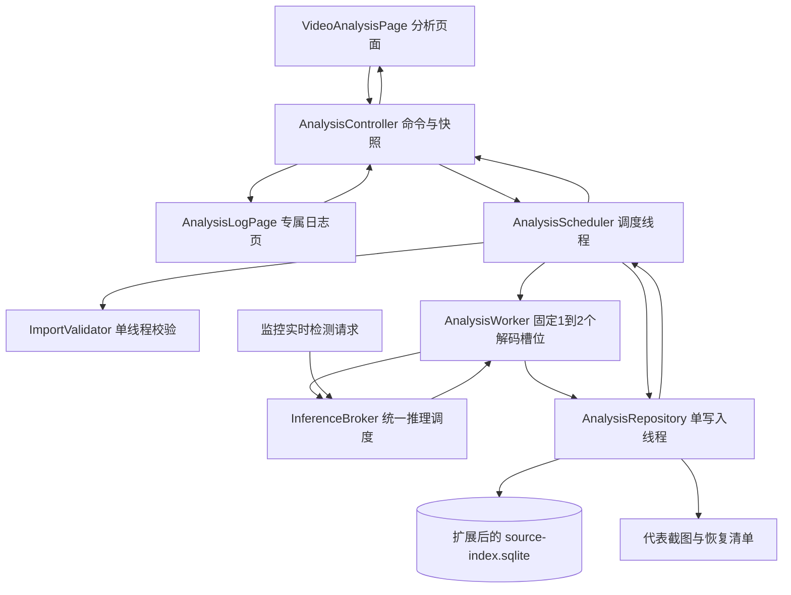
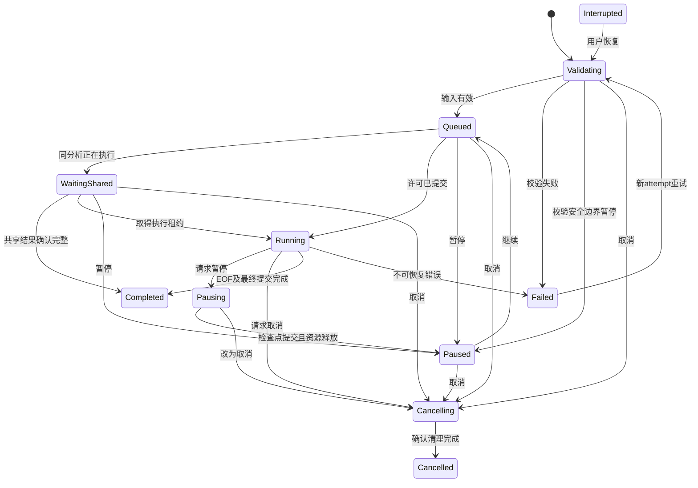

# 本地视频智能分析：独立功能与批处理实施方案

版本：v1.0 · 日期：2026-09-29  
状态：待实施的设计方案。本文不代表相关模块已经实现；本次不修改运行代码、不迁移数据库、不删除媒体。  
目标工程：`C:/QtProjects/day20_smart_monitor`

## 1. 方案结论

把现有“本地视频事件”升级为一级功能“视频分析”，页面标题“本地视频智能分析”。核心是让用户一次导入多批视频，后台按队列完成分析，生成可定位原视频的检测事件，同时可查看每个任务的进度、状态、资源使用与专属日志。

推荐结构：**批次管理 → 持久化任务队列 → 有限数量解码任务 → 统一推理调度 → 事件与检查点存储 → 结果回放和分析日志**。

首版默认只运行 1 个离线分析任务，完成稳定性验收后允许调至 2 个；不按文件数无限创建线程，也不为每个检测到的人创建线程。CPU 为默认后端，GPU 仍是可选加速。实时监控和离线分析共同运行时，优先保障监控预览、录像和实时检测。

### 1.1 对“人物/任务”的理解

本方案按“多批视频分析任务排队批处理”设计。人物是检测结果，任务才是调度对象。

- 批次：一次导入操作，例如“9月29日白班，共20个视频”。
- 任务：某个视频按一组固定参数进行一次分析。
- 运行尝试：任务失败重试或恢复后的一次执行，用 attempt/runGeneration 区分。
- 事件：视频中检测到人的连续时间区间，不等于独立人物数量。
- 若以后确实需要“同一个人从出现到消失”的生命周期，应另加目标跟踪模块；trackId 仅代表单段视频内的轨迹，不能据此宣称跨视频身份识别。此能力不纳入本期。

### 1.2 两个业务用途分开

| 项目 | 实时监控中的视频模拟源 | 独立视频分析 |
| --- | --- | --- |
| 用途 | 用本地文件模拟摄像头输入，演示监控流程 | 对已有视频批量检索有人出现的片段 |
| 速度 | 按原帧率，允许循环 | 按资源预算尽快分析，一次完成 |
| 归属 | 监控通道 | 批次和分析任务 |
| 生命周期 | 通道启停、换源 | 排队、暂停、恢复、取消、完成 |
| 结果 | 由监控需求定义录像与异常取证 | 事件时间段、代表截图、原视频定位 |

新增独立分析不能顺带删除监控页的文件模拟源。当前文件模拟源依赖旧分析器产生检测框；迁移期间保留兼容连接。是否把模拟源补齐为与摄像头一致的分段录像、三图和约60秒事件录像，另列需求差异整改，不在本方案中静默改变。

## 2. 当前基础与缺口

以下为本次读取工程代码后的事实；后文新增模块均为设计。

| 当前模块/行为 | 可复用部分 | 需要调整的部分 |
| --- | --- | --- |
| SourceAnalysisWorker | 文件散列、按时间取样、事件合并、检查点、索引查询 | Job 绑定 channel 1～4；cancel 是整个 Worker 的终止标志；缺少单任务暂停、取消与批次调度 |
| jobs_ / channels_ / tick() | 已有轮转处理，不是完全空白起步 | 没有独立的持久化等待队列，解绑通道会回收相应运行 Job |
| SharedDetectionEngine / DetectionWorker | CPU/DirectML、真实预热、回退、NMS、模型共享 | 同一个引擎通过 ticket 串行推理；不同模型/后端也缺少统一资源预算；FIFO 不等于实时优先 |
| source-index.sqlite，user_version=1 | assets、analyses、samples、events、检查点和通道历史关系 | 无任务、批次、运行尝试、结构化分析日志；不能直接容纳完整调度语义 |
| PlaybackPage | 原视频定位、内容校验、播放/停止、暂停/继续、倍速 | 本地事件 UI 与历史录像耦合，应拆出独立分析页面，抽取共用播放器组件 |
| OperationLogPage / Service / Model | 操作日志、摄像头异常事件、现有身份与审计 | 缺少 taskId/batchId/attemptId 维度的离线分析日志 |
| MonitoringController | 统一线程生命周期、资源百分比、监控服务 | 不宜继续堆入离线任务业务；新增独立 AnalysisController，更新线程归属测试 |

关键限制：**新增两个解码线程不等于模型能同时推理两次。** 在现有共享引擎上盲目增加线程，可能只是增加排队、CPU线程竞争和内存占用。

## 3. 首版范围与产品交互

### 3.1 一级入口与页面

新增一级入口“视频分析”，保留“监控”“录像回放”“图片”“日志”“设置”。顶部空间不足时调整导航布局，不通过挤压视频显示区域硬塞按钮。

分析页建议采用左右分区加详情标签：

```text
本地视频智能分析
[添加视频] [开始队列] [暂停队列] [取消所选]   [优先GPU]  并发：1

批次/任务列表                         原视频预览与事件时间轴
名称  状态  进度  事件数               [播放/停止] [暂停/继续] [倍速]
批次 A                               --------------------------------
  视频 1  分析中  46%  3              [检测事件] [任务日志] [参数详情]
  视频 2  排队中   —   —              截图 | 开始时间 | 结束时间 | 置信度
批次 B
  视频 3  已完成 100%  8

本程序资源：CPU xx%  GPU xx%  内存 xx%   后端：CPU / DirectML / 回退原因
```

- 导入多个文件形成一个批次，可命名；分析参数先随批次复制到每个任务。
- 列表支持批次、状态、时间、文件名筛选；大量记录采用分页/增量加载的 QAbstractTableModel，不一次构建上千个复杂控件。
- 任务进度以已提交检查点对应的源时间 / 视频时长计算，提交成功后才推进；时长未知时显示已分析源时间，不伪造百分比。
- 批次进度仅在子任务时长已知时按时长加权；另显示完成/失败/取消数量。部分失败不能显示“全部成功”。
- 点击任务查看事件；点击事件定位原视频，双击截图放大。视频时间偏移与实际分析时间分开显示。
- 任务运行时参数只读；改模型、阈值、采样间隔会创建新分析版本。设备偏好可按下文规则热切换。
- 页面切换不停止任务；登出后清空结果展示并禁止操作，已有任务可继续，保持当前项目后台运行习惯。关闭整个程序需执行有序停止。

### 3.2 首版保留与延期

首版包含：多批导入、排队、公平调度、单任务/批次暂停恢复取消、失败重试、断点恢复、结果复用、事件定位、截图、专属日志、资源显示。

延期：目标跟踪/人物身份、跨视频关联、多机分布式队列、多 GPU 调度、任意模型平台、自动生成分析报告、事件片段重新编码导出。首版不自动重编码原视频。

## 4. 模块与线程架构



| 模块 | 职责 | 不应承担的职责 |
| --- | --- | --- |
| VideoAnalysisPage | 批次、任务、事件 UI，发出用户命令 | SQL、散列、模型推理、线程创建 |
| AnalysisController | 权限检查、异步命令转发、页面快照、分析服务启动/停止 | 解码循环、在 GUI 中等待线程或执行 SQL |
| AnalysisScheduler | 唯一调度状态机、队列次序、资源许可、重试和关闭协调 | 持有播放器、执行耗时推理 |
| ImportValidator | 有界文件检查、元数据、内容散列、重复判断前置数据 | 自动重录或移动原视频 |
| AnalysisWorker | 持有一个视频解码上下文；按 PTS 取样；事件聚合状态 | 自行创建无限线程、越过许可持续投递帧 |
| InferenceBroker | 请求分类、公平性、CPU/GPU会话与在途预算、回退通知 | UI、数据库操作 |
| AnalysisRepository / Model | 唯一写连接、任务状态/结果/日志事务、分页查询、迁移 | 持有解码器或访问页面 |
| AnalysisLogService / Page | 结构化日志协议、筛选、详情、跳转任务、导出 | 把每帧输出全写进日志 |
| PlaybackView | 可复用播放器、时间轴、两按钮、倍速、定位 | 视频记录查询、任务调度、数据库连接 |

线程规划：GUI 1 个；调度 1 个；文件校验 1 个；离线解码固定 1～2 个；推理执行默认 1 个；存储 1 个。它们不是每批各一套。已有实时采集/录像线程保留。首期可先在一个离线 Worker 中完成解码与调用串行推理，再按同一接口拆出 Broker；正式允许“实时与离线同时重负载”前，必须接入统一推理预算。

新控制器与 MonitoringController 同级，由 MainWidget 只负责连接。两者均不访问 QWidget；停止顺序由应用关闭协调入口明确控制。现有“所有线程必须归 MonitoringController”的测试应改为“各后台线程必须归其所属控制器、页面不拥有后台线程”，不能简单删除生命周期检查。

## 5. 多批任务队列与公平性

### 5.1 三层队列

1. 导入/校验队列：只排文件描述，不预先打开全部视频。校验按块检查取消标志；大文件散列不占用 GUI 或调度线程。
2. 持久化分析等待队列：存 taskId、batchId、优先级、入队序号和状态；重启后仍可查询。
3. 有界运行管线：解码样本 → 推理 → 结果提交。运行队列只保存少量在途数据，不缓存整段视频。

推荐起始上限（待本机压力测试校准，不是已测吞吐保证）：单批最多100个文件；全局非终态任务最多500个；校验1个；离线活动任务默认1、上限2；每活动任务最多1个未确认样本；离线待提交样本总计最多2个，并限制有效像素缓冲预算128MiB。需要预留克隆、模型 blob、缩放副本的额度，不能只按 Mat 头大小计数。超限文件明确拒绝或采用经过定义的下采样流程，不静默爆内存。

### 5.2 批次间顺序

同优先级下，按批次轮询选择下一任务，批次内部按导入序号 FIFO。例如 A 有100个视频、B有2个视频，B 不应等待 A 全部完成。已运行任务默认不被新批次抢占；长视频在单槽位下仍可能让后到任务等待，应在界面明确说明，不能宣称时间片抢占已实现。

暂停队列只停止发放新许可，正在执行的任务继续；“暂停批次/任务”才进入检查点暂停。批次状态由子任务汇总，使用“部分完成/部分失败”等状态，不再维护一套容易与任务冲突的人工状态。

### 5.3 任务去重与结果复用

- 内容 SHA-256 + 模型 SHA-256 + 算法版本 + 阈值 + 采样/事件合并参数组成 analysisKey；设备执行信息另存 attempt 元数据。
- 两批导入同内容同配置：创建可追踪的独立任务行，共享一份分析结果。数据库保证同一 analysisKey 最多一个执行者。
- 后来的任务进入 WaitingShared，显示其正在复用的执行进度；取消一个等待者不取消其他任务。暂停执行者时释放执行租约，调度器可以把执行权交给其他仍处于可运行状态的等待任务，并记录接管日志。没有可运行引用时，停止共享分析上下文。
- Completed 结果才可直接命中缓存。部分样本、失败状态或截图缺失不能冒充完整缓存。
- 要求严格可复现的任务另将后端/执行精度纳入 profile，禁用跨后端结果复用；普通模式允许CPU/GPU切换，但记录后端时间区间，并验证结果差异在验收允许范围内，不能承诺位级一致。

## 6. 并发与实时监控共存

### 6.1 推理层的默认策略

同一会话串行使用；首版整个推理系统最多1个重推理在途，避免 CPU 和 GPU 两套会话同时把机器压满。2个离线任务可交错解码与等待，但不代表2个模型 forward 同时执行。

InferenceBroker 统一接收实时通道和离线任务的请求。首版建议按“最多连续3个实时请求后，若有离线请求则处理1个”作为可测试的公平策略；实时请求在通道间轮询。每路实时通道只保留最新未执行帧，旧帧覆盖；离线任务按采样顺序背压等待，不丢弃需要提交的分析样本。

这只是队列公平，不是实时延迟保证。一次原生推理通常不可被中途抢占。若监控延迟超预算，先暂停离线派发，并明确显示“为实时监控让出资源”；资源恢复后再继续。离线防饥饿与实时优先发生冲突时以监控稳定为先，并记录原因。

### 6.2 背压与限额

- 推理队列满：离线停止解码下一样本，不继续占用像素内存；实时通道仅更新自己的最新帧槽。
- 存储拥塞：暂停该离线管线，等待提交确认；不在 GUI 线程阻塞，不让日志/截图无限积压。
- OpenCV CPU线程数为进程启动级配置，任务运行中不反复修改全局线程设置；初始沿用项目上限4，解码线程候选为每路2，最终依据混合负载测试调优。
- 高CPU、内存或GPU占用先降低离线并发到1，再暂停派发；需要持续时间与恢复回差避免频繁开关。指标不可用时保留保守配额，不当成0%而扩大并发。
- 资源行显示整个应用进程的占用，不声称能准确拆分到某个任务；任务另显示处理速度、待推理/待提交时长和实际后端。

### 6.3 CPU/GPU热切换

设备偏好统一归应用级推理策略管理，监控页与分析页显示同一个偏好，仍默认CPU且重启恢复CPU。不要引入两个互相覆盖的全局环境变量开关。

切换：记录请求 → 暂停新推理派发 → 等待在途推理边界 → 后台建立并真实预热目标会话 → 更新 backendGeneration → 恢复派发。模型缓存锁只保护缓存元数据，模型加载和预热不持有全局缓存锁；同一 key 的并发加载需要合并。

GPU初始化失败回退CPU并写一次明确日志；运行中失败时允许在CPU重试同一个未提交样本，复用 sampleId，防止重复事件。旧会话在所有在途请求释放引用后销毁；切换前检查新旧会话共存的内存预算，不满足时先在安全边界释放旧会话再加载，期间显示切换中。普通模式切换不丢失已提交进度。

### 6.4 错误重试与单实例约束

| 故障 | 自动处理建议 | 避免的问题 |
| --- | --- | --- |
| 短暂I/O或数据库busy | 最多3次，退避1/3/10秒；不占用GUI，超限进入Failed或保存Interrupted待恢复 | 无上限重试导致队列被占满 |
| 模型损坏、格式不支持、源内容变化 | 不自动重试；显示修复建议，用户重新提交/重定位 | 对永久错误反复消耗算力 |
| GPU运行失败 | 同一backendGeneration仅尝试一次CPU回退；同sampleId重试，仍失败则终止该attempt | CPU/GPU之间无限切换和重复事件 |
| 单任务失败 | 封存错误与最后已提交检查点，释放运行槽；其他无依赖任务继续 | 一个坏文件拖死整个批次 |
| 用户点击重试 | 创建新attempt并重新校验；命令幂等，失败记录保留 | 覆盖上一次错误，失去追踪依据 |

单个索引目录只允许一个分析服务进程取得写入/调度所有权，建议使用QLockFile等跨进程锁并核对持有者存活；其他实例只读或显示已被占用。不能仅凭“数据库有WAL”就允许两个应用实例同时恢复和调度相同任务。崩溃后的执行租约回收必须在取得该进程锁后进行，避免把另一个存活实例误判为Interrupted。

## 7. 任务状态与生命周期

### 7.1 状态定义

| 状态 | 含义 | 可操作 |
| --- | --- | --- |
| Validating | 检查输入、散列、探测元数据 | 请求暂停、取消 |
| Queued | 已持久化，等待运行许可 | 暂停、取消、调整优先级 |
| WaitingShared | 等待同一analysisKey的已有执行 | 暂停、取消、查看共享进度 |
| Running | 校验通过且已取得执行许可 | 请求暂停、取消 |
| Pausing | 正在完成在途样本/提交检查点 | 等待，或升级为取消 |
| Paused | 已释放运行资源，检查点已确认 | 继续、取消 |
| Cancelling | 清理在途结果和资源 | 等待 |
| Cancelled | 本任务不再自动运行 | 查看部分结果、创建新任务 |
| Interrupted | 异常退出或启动时发现上次未收尾 | 校验后恢复、取消 |
| Failed | 输入/模型/解码/存储错误 | 查看原因、按规则重试 |
| Completed | EOF确认、结果和截图核对、最终提交成功 | 回放、查看日志、归档 |



异常退出时持久化仍为 Validating/Running/Pausing/Cancelling 的记录，下次启动统一标记 Interrupted 后核对检查点；Queued/Paused 保留原意。默认队列停止，用户点击“恢复未完成任务”后执行，避免一启动就抢占监控资源。Cancelled 不自动恢复。

### 7.2 任务、线程、模型的寿命分开

| 对象 | 创建 | 释放 |
| --- | --- | --- |
| Batch/Task 持久记录 | 导入确认后 | 用户归档/按明确保留策略清理，不随线程结束删除 |
| Attempt / RunContext | 取得调度许可后 | 完成、失败、暂停或取消确认后 |
| 解码器/当前帧/事件聚合器 | 活动RunContext在所属Worker线程建立 | 在同一线程到安全边界后释放 |
| Worker/QThread | 分析服务启动时按固定配额建立 | 应用关闭时统一退出；不会每个文件新建线程 |
| 模型会话 | 首次需要或后端切换 | 最后引用释放后，按小容量缓存策略回收 |
| 人物检测框 | 单帧/单样本结果 | 消费后释放；事件区间按需持久化 |
| QMediaPlayer | 页面/播放器组件建立 | 页面销毁；与后台分析任务寿命独立 |

所有运行消息带 taskId、attemptId、runGeneration、sampleId；查询响应另带 requestId。状态机/存储同时校验这些标识，防止暂停后旧结果、取消后迟到信号、旧页面查询覆盖新任务。跨线程仅传递值对象与明确共享的只读帧；不能把栈上cv::Mat数据的裸指针交给异步消费者。

### 7.3 暂停、取消与退出的真实含义

暂停不是挂起操作系统线程。请求到达后停止发出新样本，检查标志，完成已允许的在途样本与事件状态提交，释放解码资源后才显示Paused。长文件散列可中断，但首版不承诺保存散列算法中间状态，恢复校验可能需要重新散列。

取消排队任务可立即完成；取消运行任务进入Cancelling，停派新样本、接收安全边界确认，再写入Cancelled。结果提交与取消使用同一存储序列和期望状态版本：排在取消栅栏前且已确认的样本可保留，栅栏后的旧结果一律拒绝。

原生解码/推理调用可能阻塞，不能保证瞬时取消。控制消息在调度线程和原子请求标志中生效，Worker每个有限步骤主动检查；不能只给被长循环占住的Worker排队发一个停止槽。不得使用QThread::terminate强杀。首版依赖合作退出，若硬件调用卡死则保持“正在停止”且不谎报完成；若要求强制取消有严格上限，后续将推理/解码隔离到可重启子进程，不能靠线程强杀实现。

关闭顺序：拒绝新命令 → 暂停队列 → 通知校验/解码/推理停止派发 → 等待在途安全边界 → 提交检查点和日志 → 释放解码/会话 → 排空存储 → 在所属线程关闭数据库 → quit/wait各线程。关闭等待用异步信号协调，GUI显示停止进度；最终收到退出确认后才销毁控制器。避免GUI持锁wait而Worker又等待GUI的循环依赖。

QObject归属、排队连接和deleteLater按Qt线程规则处理；数据库连接只在创建它的线程访问，不能把GUI默认连接传给Worker。[Qt对象线程规则](https://doc.qt.io/qt-6/qobject.html)、[Qt SQL连接线程规则](https://doc.qt.io/qt-6/qsqldatabase.html)

## 8. 断点、顺序与一致性

一个样本提交包含：样本序号与PTS、检测框、事件聚合状态、截图引用、nextSampleMs、最后已提交PTS。它们应在同一数据库事务提交；任务进度仅由提交确认推进。

- 每任务默认最多1个未确认样本，简化事件顺序与恢复。若以后增加并行样本，必须按sampleId重排后再聚合事件，不能按推理完成先后合并。
- 截图先以临时文件原子写入并生成可重放清单，再提交引用；数据库成功后清单标记完成。崩溃遗留图片可作为孤立文件核对，不能把文件系统和SQL假装为同一原子事务。
- 暂停/重启恢复需保存当前活跃事件的起点、最后阳性PTS、事件键及代表截图位置，不能仅保存进度百分比。
- 首版优先采用从源头解码并跳过已提交PTS的正确性方案；后续才优化为关键帧附近seek并验证时间戳。不能假设CAP_PROP_POS_MSEC任意seek都精确。恢复较慢时显示“恢复定位中”。
- 再次校验源文件/模型内容；内容不同则创建新资产/新profile，不能把旧检查点套到新文件。首版输入要求分析期间不可修改，并在最终完成前复核文件散列；复核失败不得标记Completed。
- 唯一键约束：analysisKey+sampleId、analysisKey+eventKey、commandId、analysis执行租约。重试同一样本不重复创建事件或截图。

## 9. 数据设计与旧结果迁移

沿用独立SQLite，不把分析详细日志和任务表混进现有MySQL业务录像库。推荐在复制验证通过后，将source-index.sqlite升级为版本2；原有表优先保留，扩展命名避免歧义。

| 表/数据 | 主要字段与用途 |
| --- | --- |
| analysis_batches | batch_id、name、created_by、created_at、default_profile；不强存可从任务汇总的进度 |
| analysis_tasks | task_id、batch_id、asset_id、analysis_key、state、priority、queue_seq、state_revision、last_error_code、created_at |
| analysis_attempts | attempt_id、task_id、run_generation、started/ended_at、requested/actual_backend、runtime_version、result、error_code |
| analysis_commands | command_id、task_id/batch_id、actor_id、action、expected_revision、result，保证重复点击幂等 |
| analysis_leases | analysis_key唯一、owner_task_id、attempt_id、generation，确定共享分析唯一执行者 |
| analyses（扩展） | profile_json、profile_hash、algorithm_version、检查点、完整性状态；沿用已有可映射字段 |
| analysis_logs | log_id、command_id、batch_id、task_id、attempt_id、event_key、level、category、code、actor_id、occurred_at、message、context_json |
| audit_outbox | event_uuid、目标审计类型、投递状态；与分析状态同事务写入，供业务审计异步桥接 |
| assets / events / samples | 复用现有资产、PTS事件和样本数据，保持历史键可追溯 |

analysis_logs索引至少覆盖(task_id,log_id)、(batch_id,log_id)、(level,occurred_at)、(code,occurred_at)。模型版本和参数快照必须可查，不能只存一个后来可能被覆盖的模型路径。

存储采用单写入线程，短事务；查询使用其线程内连接或专门只读连接，分页返回。SQLite WAL允许读写并存，但仍只有一个写者，不能靠多个写线程提高写入并发。[SQLite WAL说明](https://www.sqlite.org/wal.html)

迁移流程：停止旧索引写入 → 用一致性备份或完整关闭后的副本留存v1 → 在隔离副本迁移与核对 → 新程序切换 → 保留原备份。运行中的WAL库不能仅复制主.db文件来当完整备份。[SQLite在线备份](https://www.sqlite.org/backup.html)

旧analyses映射为“历史导入”批次：完整且媒体齐全的作为历史完成结果；缺少上下文的未完成记录只读归档或标Interrupted，不猜测可恢复。通道关系保留为来源备注，独立任务查询不再强制依赖通道。截图路径和原视频都不自动移动/删除；旧程序不得直接打开升级后的库，回滚用对应v1副本。实际迁移另行实施，本方案不执行。

## 10. 专属视频分析日志

### 10.1 界面入口

“日志”一级页面新增“视频分析”标签，与“操作日志”“监控异常事件”并列；每个分析任务详情再提供“任务日志”标签，两者查询同一份analysis_logs，避免双份数据。

筛选：时间、批次、任务、状态、级别、错误码、操作者、关键字。详情可展开后端、模型版本、重试次数、检查点、耗时等上下文。任务日志双击可跳到任务；含eventKey时可定位对应事件；任务已归档时给只读详情，不跳转空页面。

### 10.2 记录什么

| 类别 | 示例code | 必要上下文 |
| --- | --- | --- |
| 导入/校验 | IMPORT_ACCEPTED、SOURCE_MISSING、SOURCE_CHANGED | 批次/任务、文件身份、校验结果 |
| 排队/调度 | TASK_QUEUED、TASK_STARTED、WAITING_SHARED、RESOURCE_WAIT | 调度原因、优先级、共享analysisKey |
| 生命周期 | TASK_PAUSE_REQUESTED、TASK_PAUSED、TASK_RESUMED、TASK_CANCELLED | commandId、actorId、attemptId、已提交位置 |
| 检测结果 | EVENT_OPENED、EVENT_CLOSED、TASK_COMPLETED | eventKey、源起止PTS、事件总数 |
| 设备/性能 | BACKEND_SWITCHED、GPU_FALLBACK、RESOURCE_THROTTLED | 请求后端、实际后端、原因、影响任务 |
| 故障/恢复 | DECODE_FAILED、MODEL_LOAD_FAILED、STORAGE_FULL、TASK_INTERRUPTED、TASK_RETRY | 错误码、诊断摘要、可否恢复、检查点 |
| 结果管理 | CACHE_REUSED、SOURCE_RELOCATED、RESULT_ARCHIVED | 旧新引用、执行者、结果完整性 |

级别用INFO/WARN/ERROR；DEBUG按需启用。不记录每帧“检测到人”；事件开启/关闭各一条，资源指标最多按60秒摘要或异常状态变化记录。相同重复错误合并计数，避免日志把数据库写满。

### 10.3 可靠性与业务审计

任务状态变更与该次分析日志同事务提交：没有成功记录“已暂停”就不能向UI确认暂停完成。运行者actor_id为空表示系统动作；导入/取消等保留真实发起人，不用任务执行时恰好登录的人覆盖操作者。

现有operation_log只记录批次创建、取消、导出、归档等业务操作摘要。详细分析日志不逐条复制过去。跨SQLite与MySQL不做伪原子事务：采用outbox异步桥接，并按event_uuid幂等投递；若旧审计表缺少唯一事件标识，先只保留SQLite详细记录并展示同步待办，相关业务库结构变更另行明确，不能未经设计承诺恰好一次。

日志队列候选上限256条或2MiB（两者先到即限流）。DEBUG可丢弃并统计，重复INFO可合并；生命周期/ERROR先持久化或进入有界恢复清单。磁盘满且恢复清单也不可写时停止派发新任务，界面持续报警，不让无日志的失败继续扩大。日志本身写入失败只走一次备用诊断通道，避免递归记录失败。

首版不自动清除业务日志。后续若增加保留期限，需可配置、可导出，并与任务/事件引用和备份策略协同。导出默认脱敏完整路径和账户信息，不记录密码、连接字符串或媒体像素。

## 11. 对外接口草案

以下为计划中的Qt命令/信号，不是已存在的HTTP接口。所有命令异步返回commandId；命令接收不等于执行完成。

```cpp
// UI -> AnalysisController，执行权限检查后转发
QUuid importBatch(const ImportRequest &request);
QUuid startQueue();
QUuid pauseQueue();                    // 仅停止派发新任务
QUuid pauseTasks(const QList<QUuid> &taskIds);
QUuid resumeTasks(const QList<QUuid> &taskIds);
QUuid cancelTasks(const QList<QUuid> &taskIds);
QUuid retryTask(const QUuid &taskId);   // 新attempt，先核对输入
QUuid setMaxConcurrentTasks(int count); // 首版限定1～2
QUuid queryTasks(const TaskFilter &, const PageRequest &);
QUuid queryEvents(const QUuid &taskId, const PageRequest &);
QUuid queryLogs(const AnalysisLogFilter &, const PageRequest &);

// 后台 -> Controller -> UI，消息为可注册的值对象
void commandFinished(QUuid commandId, CommandResult result);
void taskChanged(TaskSnapshot task);  // 含stateRevision与实际后端
void batchChanged(BatchSnapshot batch);
void tasksReady(QUuid requestId, TaskPage page);
void eventsReady(QUuid requestId, AnalysisEventPage page);
void logsReady(QUuid requestId, AnalysisLogPageData page);
void shutdownFinished();
```

取消/暂停等命令必须校验当前状态版本；重复commandId返回相同结果。快照推送建议每任务不超过4次/秒，状态变化即时推送；资源百分比继续沿用现有每秒采样。不把Worker裸指针暴露给页面。

新增权限建议为AnalysisView、AnalysisControl、AnalysisExport、AnalysisArchive，先按当前角色策略映射，不新增一套登录系统。Scheduler不接受未经Controller校验的UI命令；后台恢复使用系统身份。任务切页后查询requestId过期则丢弃，登出立即清掉敏感结果。

## 12. 事件和“人物生命周期”的可选扩展

当前事件仍表示“这段时间内存在人形”，可保存一张代表截图。任务内的事件聚合器维护activeEvent、firstPositivePts、lastPositivePts、代表截图；阴性间隔超过合并阈值则封口。暂停时保留聚合器检查点，不能因为暂停把同一事件切成两条。

如果未来需要“每个人分别计数/轨迹”：新增PersonTracker，只在对应任务Worker内维护trackId、bbox、first/lastSeen、丢失帧数；多个轨迹共享一个任务线程。轨迹状态按采样变化更新，不新建人物线程。跟踪引入后要重做采样间隔、遮挡、轨迹重连和人数准确率验证；不能沿用0.5秒低频采样就宣称身份稳定。此项需新的模型/算法及验收，单独排期。

## 13. 分阶段实施与交付

每阶段完成后保留可运行版本；先做到“一个任务完整可控”，再扩大并发。以下为顺序与验收门槛，不承诺固定开发天数。

| 阶段 | 实施内容 | 交付与门槛 |
| --- | --- | --- |
| P0 契约与基线 | 固定task/profile/command结构；梳理旧索引；记录混合负载基线 | 设计核对、隔离v1样本库、现有测试仍通过 |
| P1 独立页面与单任务 | AnalysisController、AnalysisWorker；拆分播放器；旧结果只读适配；最小日志协议 | 不依赖通道即可导入1个视频、分析、看事件、定位原视频；监控模拟源仍可用 |
| P2 持久队列与日志 | Batch/Task/Attempt状态机、SQLite v2、单写存储、专属日志页、串行批处理 | 多批FIFO/轮询、任务日志可追踪、重启后队列不丢；不能仅保存在内存 |
| P3 暂停取消与恢复 | RunGeneration、栅栏、检查点、去重租约、错误分类、关闭协调 | 取消不再产生新结果，重复恢复无重复事件，崩溃恢复可核对 |
| P4 有界并发与统一推理 | 固定双槽位、全局预算、实时/离线公平调度、CPU/GPU切换 | 默认1；混合负载达标后才开放2；结果与串行一致性验证通过 |
| P5 迁移与收口 | 历史批次导入、导航切换、删除已被替代的旧标签及连接、文档和打包 | 历史结果仍可回放，摄像头录像正常，旧源模拟框链路有明确归属 |

推荐文件组织（新增，不代表已实现）：

```text
model/analysis/       batch、task、attempt、profile、command、snapshot、log DTO
service/analysis/    controller、scheduler、worker、importvalidator、repository
service/inference/   broker、request、sessioncache（逐步接管共享检测引擎）
view/analysis/       analysispage、tasktablemodel、eventlistmodel、analysislogpage
view/playbackview.*  共用播放器组件
database/           文件索引v2迁移与回滚说明（不直接迁移业务MySQL）
tests/               queue、lifecycle、repository、logs、mixed-workload、analysis-ui
```

不要在第一步大面积重写所有模块。保留DetectionWorker后处理和现有媒体链路，从接口隔离开始；只有新页面、结果回放和历史迁移通过验收后，才移除原“本地视频事件”UI。

## 14. 必测场景与验收指标

数值均为建议验收目标，需本机基线校准，不是已经达到的结果。

| 类别 | 场景 | 通过标准 |
| --- | --- | --- |
| 批处理 | A批100个文件、B批2个文件、跨批重复导入 | 等待队列持久化；B可在轮询槽位获得执行；同analysisKey最多1执行者 |
| 资源有界 | 达到500个非终态任务、超额继续导入 | 明确限额反馈；Worker数量固定；像素和日志队列均不越过预算 |
| 状态机 | 重复点击、暂停立即取消、完成与取消同时到达 | 状态转移合法；command幂等；终态不被旧结果改回Running |
| 暂停恢复 | 校验中、解码中、推理中、写库前后暂停 | UI显示请求与确认区别；已提交位置一致；无重复事件 |
| 共享任务 | 两批引用同一结果，暂停/取消其中一个 | 其他有效任务可继续或取得执行租约；无多写者 |
| 崩溃恢复 | 截图落盘后SQL前、SQL成功后ACK前强制结束测试进程 | 原视频hash不变；无重复样本/事件；不把残缺结果标完成 |
| 错误输入 | 文件消失、同名替换、模型损坏、未知时长、非单调PTS | 准确错误码与任务日志；不污染其他任务；未知进度不伪造 |
| 数据库 | busy、只读、磁盘满、迁移失败 | 有界重试后暂停/失败；恢复清单可追溯；保留旧库和原视频 |
| GPU | 不可用、初始化失败、运行失败、连续CPU/GPU切换 | 有实际后端提示；回退有日志；同sample只提交一次 |
| 回放 | 校验期间停止、任务切换后旧回复、退出登录 | 迟到回复不播放错误视频；沿用两按钮真实状态行为 |
| 日志 | 按任务/批次筛选、导出、UI切页、写入失败 | 生命周期与状态可对应；无每帧日志洪水；业务审计重复投递不重复插入 |
| 并发准确性 | 同素材串行与双槽位分析 | PTS顺序、样本数、事件边界一致；CPU/GPU数值差异另设容差 |
| 混合负载 | 四路预览/录像 + 离线1/2任务，CPU和GPU分别测试 | GUI心跳P95候选≤100ms，预览相对无离线基线下降候选≤10%；不丢失已封口录像；超预算会让出资源 |
| 长稳与退出 | 8小时队列循环、反复开关页面、关闭中取消 | 线程/句柄/内存无持续单调增长；无跨线程SQL/析构警告；硬件长稳保留证据 |

自动测试仅使用临时目录、SQLite或明确隔离库，真实GPU测试标明硬件前提。按模块运行测试；发布前按工程约定执行scripts/build-and-test.ps1及媒体端到端验证。单元测试数量不能替代混合负载、实际硬件和长稳验收。

## 15. 本方案确定的默认决策与后续边界

- 多批任务是视频文件分析任务，不是人物线程；人物跟踪为独立后续能力。
- 一级功能名“视频分析”，日志一级页面中新增专属“视频分析”标签。
- 默认CPU、离线并发1，稳定后开放2；实时优先，所有队列有上限。
- 首版仍单机桌面进程，应用关闭就停止工作；不引入Redis、消息中间件或后台Windows服务。
- 默认登出后后台继续；重启后未完成任务等待用户恢复，不自动满负载运行。
- 沿用独立SQLite并规范迁移；原视频只读，首版无自动媒体删除，旧结果先归档。
- 当前实时模拟源暂保留兼容链路；本方案独立分析上线，不等于已解决模拟源的普通/事件录像需求差异。

## 16. 本次方案验证记录

已对照现有SourceAnalysisWorker、SharedDetectionEngine、MonitoringController、PlaybackPage、OperationLogPage及数据恢复契约完成静态梳理，并核对Qt线程/SQL与SQLite WAL文档。本文将拟新增能力与已有能力明确分开。

本次交付仅为设计文档；未运行新功能测试、未执行数据库迁移，也未声称并发或长期性能指标达标。后续开发按P0～P5推进。