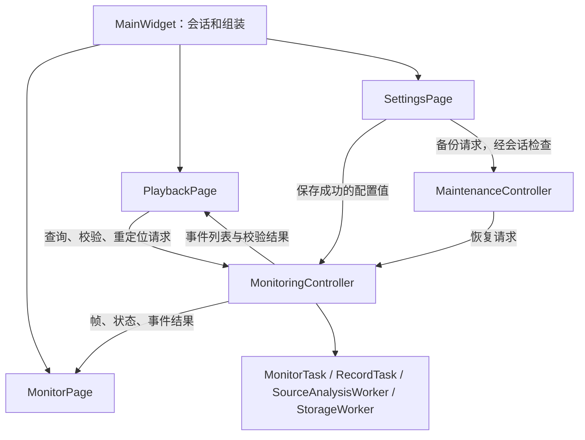

# MainWidget 组件拆分与审查记录

日期：2026-09-27。目标是迁移状态、行为和所有权，避免同一个大类仅按文件分散。

## 当前职责

| 组件 | 持有的状态 | 对外协作 |
| --- | --- | --- |
| MainWidget | 顶部导航、页面指针、AuthSession | 组装页面，连接信号，登录/注销，集中审计 |
| PlaybackPage | QMediaPlayer/QAudioOutput、录像查询条件、页码、当前录像、异步请求编号 | 发送事件查询/校验/重定位请求，接收结果，发出导航和审计请求 |
| MonitorPage | 通道显示快照、选中通道、布局、截图源帧、显示权限 | 接收帧和状态，发送刷新设备/检测开关请求 |
| SettingsPage | 表单、设备枚举、已保存配置快照、配置加载提示 | 通过已有 Service 保存，成功后发送 channelsSaved/storageSaved/detectionSaved |
| MonitoringController | 通道运行配置、四路线程和任务、帧邮箱、文件分析、StorageWorker | 接收已保存配置，发送帧/状态/错误/文件事件，负责线程启停和收尾 |
| MaintenanceController | BackupService、每日检查/恢复定时器、备份发起者 | 请求媒体重放，发布备份状态、提示和审计 |

三个页面独立继承 QFrame，保留原来的对象名称和样式选择器。页面不接收 MainWidget 指针，不引用其他页面控件或任何 worker；控制器不引用 QWidget、按钮或标签。SourceEventRow 被提取为单独值类型，页面无需包含分析线程实现。没有共享的全局“大上下文”、friend 或公开控件集合。

## 分阶段定位

1. **回放页**：迁移播放器、列表、查询/定位状态、文件事件交互；主窗口仅保留信号桥接。主程序构建/启动检查通过，主窗口集成测试 28 项通过。原始报告：artifacts/verification/refactor-stage1.json。
2. **设置与监控页**：移走表单和设备枚举、显示控件、通道选择、截图源帧。测试显式包含自身所用服务，回放/画面操作改为定位所属页面。主程序构建/启动检查通过，主窗口集成测试 28 项通过。报告：artifacts/verification/refactor-stage2.json。
3. **后台与维护**：线程和邮箱迁入 MonitoringController，维护定时器迁入 MaintenanceController；MainWidget 不再持有后台任务或页面内部成员。原 mainwidget_* 分文件已由独立组件取代。增加所有权、独立页面权限、迟到回调、幂等退出四项测试。主窗口 32 项通过；第三阶段其余结果与最终全量回归见 artifacts/verification/refactor-stage3.json 和 latest.json。

阶段快照保存于忽略目录 artifacts/refactor-baseline、refactor-stage1、refactor-stage2；用于本机比较，不随源码提交。三个阶段都先验证后推进，没有靠修改预期结果掩盖运行失败。

## 审查发现与处理

- **隐式 include 依赖**：原测试从 MainWidget 间接获得 ConfigModel/VideoModel/ChannelConfigService 声明。改为显式包含，测试仍验证相同用户行为。
- **注销期间的异步回放**：PlaybackPage 撤销权限时停止播放、清空选择、递增请求编号并关闭截图弹窗。旧请求即使在重新登录后返回也不会恢复旧视频；新增独立页面测试覆盖。
- **退出阶段的预览回调**：GUI 消费邮箱时再次检查投递开关和 shutting_down 状态，避免排队帧在退出过程中绘制。
- **后台生命周期**：仍按停采集/等采集线程退出 → 停录像/处理最后回调 → 等录像线程退出 → 等分析线程退出 → 存储收尾顺序执行。shutdown 可重复调用；MainWidget 在子页面析构前主动调用。
- **构造期间的配置告警**：SettingsPage 暂存启动加载告警，主窗口完成连接后显示，避免构造期间发出的信号丢失。
- **检测开关失败**：使用 detectionToggleRejected 恢复显示，不发送配置保存成功信号，也不重新启动检测。
- **视觉兼容**：保留 QFrame 基类和原 objectName；未改变页面布局或已有控件文案。
- **低磁盘告警审计**：补齐设置保存时的系统审计转发，显式 actorId=0 不会被当前登录者覆盖；新增测试同时验证系统身份和默认当前用户身份。
- **维护权限与数据库**：后台自动维护不依赖登录；手动备份经主窗口会话检查。自动测试仍使用隔离 SQLite 和临时媒体，无生产数据库迁移。

## 如何定位问题

| 现象 | 先看入口 | 再沿信号查看 |
| --- | --- | --- |
| 回放/时间定位错误 | PlaybackPage::open_linked_video、receiveSourcePlayback | sourcePlaybackRequested → MonitoringController::resolveSourcePlayback |
| 保存设置未生效 | SettingsPage 的 save_* 方法 | channelsSaved/storageSaved/detectionSaved → 控制器 set* |
| 单/四画面或截图错误 | MonitorPage::display_frame、show_single_window、take_preview_snapshot | 控制器 frameReady/captureStateChanged |
| 采集、录像、退出卡住 | MonitoringController::init_workers、shutdown_workers | 各 worker 的 queued/direct 连接和存储队列 |
| 退出登录后出现旧内容 | MainWidget::logout、各页面 setAccessEnabled | PlaybackPage 请求编号、控制器帧投递门控 |
| 自动备份或恢复失败 | MaintenanceController::backupIfDue、startBackup | recoveryRequested → MonitoringController::requestRecovery |

完整验证在所有源码与文档固定后执行；latest.json 必须为 passed 且 sourceFingerprint 与当前输入匹配。真实四摄像头、全新 Windows 安装、断电和 7×24 小时长稳仍需实机验收。

界面检查截图位于 artifacts/verification/mainwidget-refactor-ui，包括监控、设置、图片、回放和真实视频解码帧。
